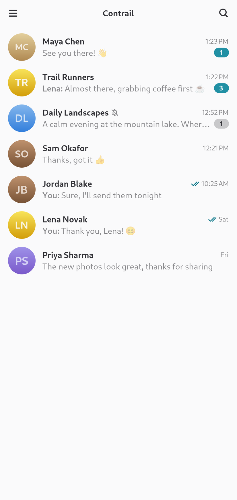
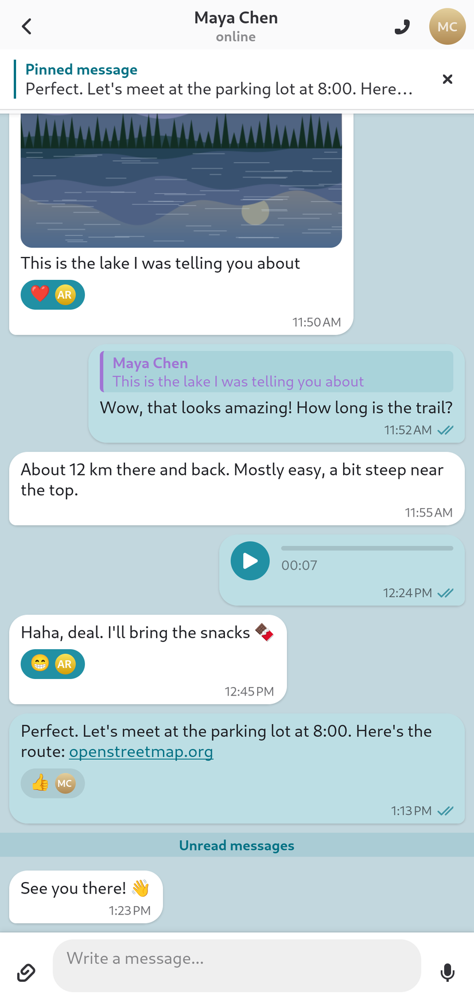
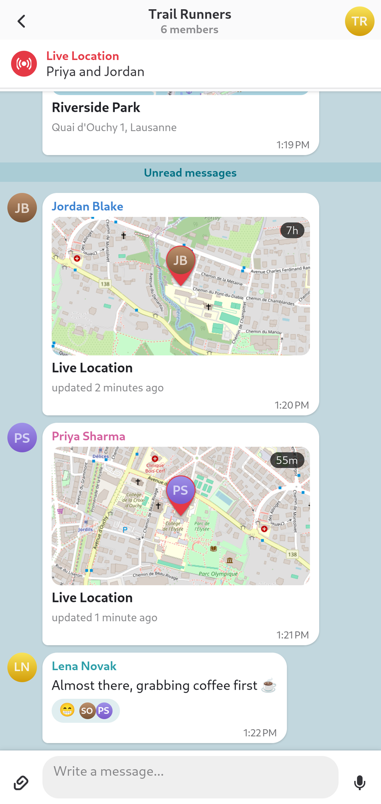
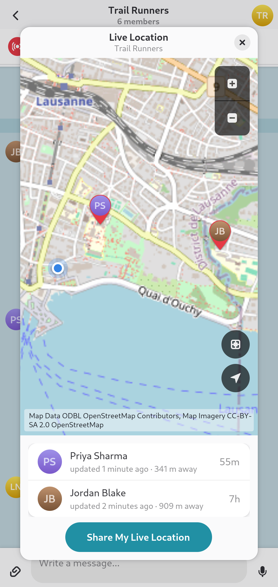
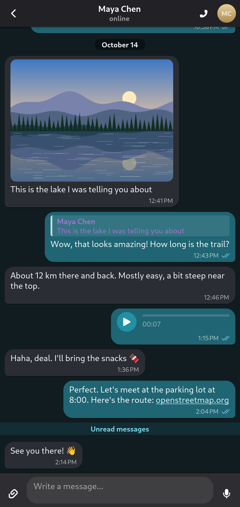
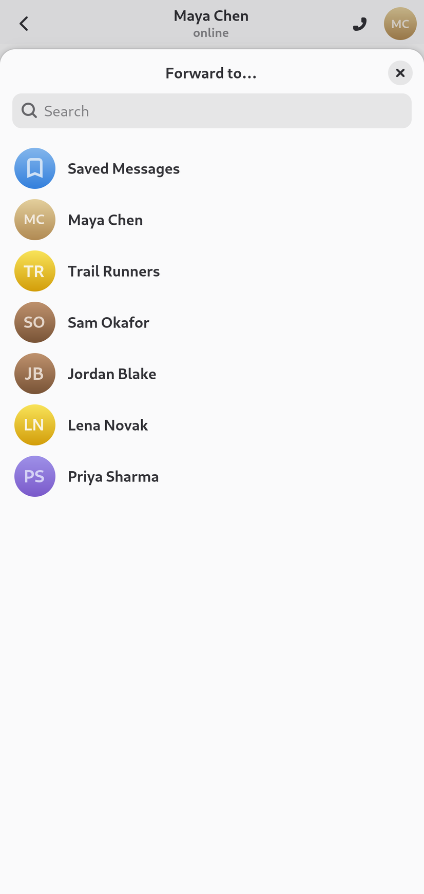
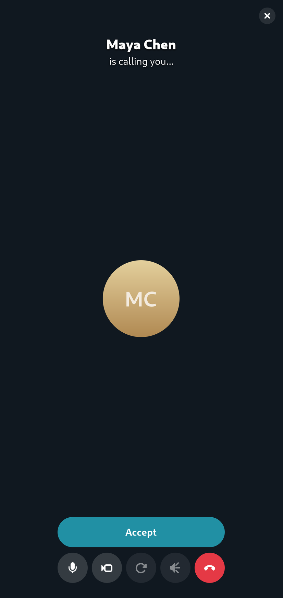
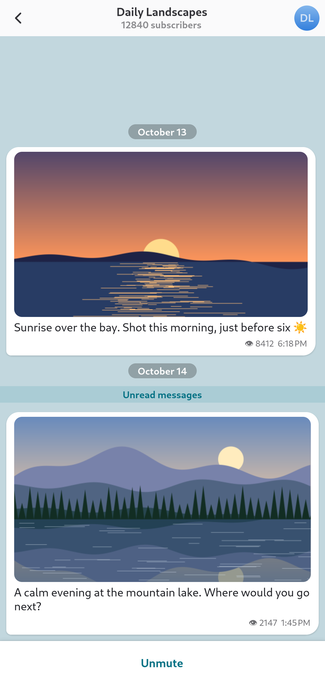

<div align="center">


# Contrail

**A native GNOME (GTK4 + libadwaita) interface for Telegram on Linux phones**

Built on [TDLib](https://github.com/tdlib/td) · made for Phosh ·
developed on the FuriLabs FLX1s with FuriOS

</div>

<p align="center">
  
  
  
  
</p>
<p align="center">
  
  
  
  
</p>

> [!NOTE]
> Contrail is an **unofficial** client that uses the Telegram API. It is not affiliated with or endorsed by Telegram. The chats in the
> screenshots are made up (see [Screenshots](#screenshots)).

Contrail uses TDLib for the Telegram connection, message database and files. Its adaptive
GTK4/libadwaita interface uses a single column on a phone and shows the chat list and the chat side by
side on a wider screen. It supports touch gestures and follows the system's style and accent color.

Contrail has its own [Flatpak repository](#from-the-flatpak-repository): add it once, and new versions come
through your app store or `flatpak update`.

## Supported systems

| Tier | Systems | Meaning |
| --- | --- | --- |
| Supported | FuriOS on the FuriPhone FLX1s | Tested before each release |
| May work | Mobian, PureOS and other Debian-based Phosh systems on ARM64 | Flatpak or DEB for ARM64; not verified, fixes are best effort |
| Not supported | Desktop PCs, x86_64 (`amd64`) and other systems | No packages |

Packages come for ARM64 (`arm64`, `aarch64`) only, as a Flatpak and a DEB. Contrail 0.3.1 remains the last
release for x86_64 and the last one as an RPM or an AppImage. Its files stay on the
[releases page](https://github.com/x-vlad-x/contrail/releases/tag/v0.3.1).

## Features

- **Sign-in** with a phone number, the code and the cloud password (two-step verification); sign-up for
  a new number.
- **Chat list** in Telegram's order: pinned chats, unread and mention badges, previews, drafts, read
  ticks; the archive; search by name and global search by username; pin, mute, archive, mark as read,
  delete or leave from a long press.
- **Chats**: history loaded page by page while you scroll (in both directions, without jumps), date
  separators and an "Unread messages" bar, grouped senders with avatars, replies (tap to jump),
  forwards, formatted text with links, mentions and hidden spoilers, photos, albums (photos and videos sent
  together, in Telegram's grid, each with its own taps, menu and progress; files sent together one under the
  other), stickers, files, videos and GIFs (opened in the system player), voice messages and music (played by
  the core), link previews, polls, shared contacts. Scrolling over text and links never turns into a tap.
- **Photo viewer**: pinch to zoom (up to 6×) around the point between the fingers, drag a zoomed photo,
  double tap to zoom in around the tap and back; Ctrl+wheel with a mouse.
- **Writing**: text, replies (long press or swipe left), editing (also Up in an empty field), deleting
  (for everyone too), drafts kept per chat.
- **Forwarding**: choose the chat (and the topic in a group with topics), and the messages wait above its message
  field, to go with a comment or alone, with or without the senders' names.
- **Pinned messages**: a bar with the pinned message above the chat; a tap shows it and goes on to the one pinned
  before, a list shows all of them; pinning and unpinning from a message's menu.
- **Sending files and pictures**: from the file chooser or pasted (Ctrl+V, Shift+Insert, Paste in the field's
  menu: a screenshot, an image copied in a browser, files copied in a file manager, also through Flatpak's
  portal), shown first with previews, a caption and "Send as documents" / "Group items"; pictures go as photos
  and photos and videos as albums of up to ten, larger sets in order. Pasted text stays text.
- **Reactions** as in the phone apps: under the messages with their counts, or with the avatars of the few who
  reacted; a tap on one adds yours or takes it back, a long press shows who reacted (in groups). Reactions on top
  of a message's menu, all of them a tap further, and a double tap sends your quick reaction. New reactions to your
  messages show a heart in the chat list and are read when you see them.
- **Locations** as in the phone apps: a map of the place in the chat, a tap opens it on an interactive map
  (OpenStreetMap) with "Open in Maps" for the system's map application. Sending: your current location, any place
  on the map, places nearby or found by name (Foursquare, as in the phone apps), or a **live location** for
  15 minutes, an hour, 8 hours or until you stop it; it goes on in the background and after a restart. A bar under
  the chat's header says who shares a live location there and opens one map with everyone: their pins move as they
  are updated, with how far each one is from you, and sharing or stopping yours. The GPS is used only while
  the location screen is open, and for a live location only to take a fix now and then (more often while you
  move, every two minutes while you stay): nothing keeps it on.
- **Voice messages** as in the phone apps: hold the microphone to record and release to send, slide
  left to cancel or up to keep recording hands-free.
- **Calls**: one-to-one audio and video calls — accept or decline, mute, front/back camera,
  encryption emoji, back to an ongoing call from any chat. The remote video fills the window with your
  camera in a corner. As in the phone apps, a call is heard where the sound already goes (Bluetooth or
  wired headphones), otherwise on the earpiece, and can be moved to the loudspeaker or another device;
  each of the phone's outputs keeps its own call volume, apart from the media volume. The screen goes
  dark while the phone is held to the ear, and doesn't lock during a call. An incoming call rings with the
  phone's own ringtone. Phosh shows a notification with Accept and Decline on the lock screen and
  End Call while the call goes on. With Wayland layer shell, Contrail can show full-screen controls
  for the call, including mute and loudspeaker.
- **Notifications** through the desktop's native Linux notifications, with the phone's own message sound;
  tapping one opens the chat.
- **Running in the background** (Settings): closing the window keeps messages, notifications and calls
  coming; on a desktop an icon in the notification area opens the window again, on a phone the app's
  launcher does. The interface is released meanwhile (its memory, textures and timers): opening the window
  again comes back to the same chat, draft and place in it, or to the chat a notification or a link points to.
  A voice message being recorded goes on.
- **Memory kept in check**: a chat keeps only the messages near the screen, and when the system runs short of
  memory Contrail lets go of what isn't on the screen.
- `tg://` and `t.me` links, chat info, contacts, Saved Messages, settings.
- **Every language Telegram is translated into**: the strings are Telegram Desktop's own; on the first
  start the language follows the system.

Not there yet: group calls, screen sharing, stories, selecting several messages,
sticker and emoji panels, recording video messages, folders, multiple accounts. Secret chats aren't
planned: Telegram Desktop doesn't have them either.

## Installing

### From the Flatpak repository

The easiest way, with updates through your app store or `flatpak update`: Contrail's own signed Flatpak repository,
[flatpak.xvlad.com](https://flatpak.xvlad.com), for ARM64. Open
[Contrail.flatpakref](https://flatpak.xvlad.com/io.github.x_vlad_x.Contrail.flatpakref) in GNOME Software, Discover
or another app store, or:

```bash
flatpak remote-add --user --if-not-exists flathub https://dl.flathub.org/repo/flathub.flatpakrepo
flatpak remote-add --user --if-not-exists xvlad https://flatpak.xvlad.com/xvlad.flatpakrepo
flatpak install --user xvlad io.github.x_vlad_x.Contrail
```

The GNOME runtime comes from Flathub (the first command adds it if it isn't there yet), Contrail itself from the
repository, which takes every release from this project's releases page. Coming from a downloaded `.flatpak`:
`flatpak install --user --reinstall xvlad io.github.x_vlad_x.Contrail` keeps the account and the chats.

### Packages

Download the package from the [releases page](https://github.com/x-vlad-x/contrail/releases). Both are for
ARM64:

| System | Package | Install |
| --- | --- | --- |
| FuriOS, Mobian, PureOS | `contrail_<version>-1_arm64.deb` | `sudo apt install ./contrail_*_arm64.deb` |
| Any Phosh system with Flatpak | `Contrail-<version>-aarch64.flatpak` | `flatpak install --user ./Contrail-*-aarch64.flatpak` |

The packages are ready to use: no building and no Telegram API keys needed. The DEB carries the libraries
Contrail needs and needs glibc 2.39 or newer (FuriOS 14, Debian 13 or newer); the Flatpak uses the GNOME runtime
from Flathub. The account and the cache are kept in
`~/.local/share/contrail-data/td` (the Flatpak's in `~/.var/app/io.github.x_vlad_x.Contrail/data/contrail-data/td`), separate from the
official Telegram Desktop. The installation guide that comes with each release (`README.md` among its files) has
the details, including moving from the earlier SSH install to a package (`contrail-migrate-launcher`).

On the first upgrade from Contrail 0.3 to TDLib, sign in once. Contrail carries over the language,
notification and background settings. Contrail retrieves your cloud chats again. Downloaded files
in the old cache, pending uploads and local live location state stay with 0.3.

Contrail is developed and tested on the FuriLabs FLX1s with FuriOS 14 (Phosh). Choosing where a call is heard
needs `pactl` (PulseAudio, or PipeWire's PulseAudio server; the Flatpak carries it); the earpiece and the
loudspeaker are the ports of FuriOS's PulseAudio Droid sink. The dark screen at the ear needs a proximity sensor
behind iio-sensor-proxy (or FuriOS's compatible service). The phone's ringtone comes from feedbackd.
Full-screen call controls on the lock screen need Wayland layer shell. On FuriOS this is available to the
native packages, and the Flatpak uses Phosh's lock-screen notification actions.
Your location comes from GeoClue, through the desktop portal in the Flatpak (the system asks once whether
Contrail may use it); the maps come from OpenStreetMap's tile servers and are drawn by libshumate, as in GNOME
Maps (it comes with the packages).

## Building

You need your own Telegram API credentials: `api_id` and `api_hash` at <https://my.telegram.org> (API
development tools). Put them into `api-credentials.env` in the repository (it's in `.gitignore`):

```bash
TELEGRAM_API_ID=12345
TELEGRAM_API_HASH=0123456789abcdef0123456789abcdef
```

### Packages

```bash
tools/build-packages.sh aarch64    # ARM64: DEB and Flatpak in out/packages/
tools/smoke-test.sh all            # install and check both on the phone over SSH
```

This needs git, patch, python3 and podman (or docker); everything else happens in containers. The program is
cross-compiled for ARM64 against Debian 13, once, and packaged two ways by `tools/package.py`: the DEB carries
every library the program needs except the system's base ones (`tools/bundle.py`,
`packaging/bundle-host-libraries.txt`), the Flatpak what its GNOME runtime doesn't have. FFmpeg
is built by `build-env/build-deps.sh` from Debian's source package with the codecs Contrail uses.
The build pins TDLib and uses the tgcalls sources and WebRTC dependencies specified in
`tools/build-packages.sh`. The first build takes a few hours, later ones minutes. Packages are built locally.
`tools/prepare_release.py` assembles the release files (packages, corresponding
sources, checksums) in `out/release/`, see [packaging/LICENSES.md](packaging/LICENSES.md), and
`tools/publish-release.sh` publishes them as a GitHub release.

### Development install over SSH

The default package build produces Contrail TDLib, which can run alongside Contrail 0.3. Build its DEB
and install it on a phone that accepts SSH logins with a key.

```bash
CONTRAIL_FORMATS=deb tools/build-packages.sh aarch64
scp out/packages/contrail-td_*_arm64.deb furios:
ssh -t furios 'sudo apt install ./contrail-td_*_arm64.deb'
```

It appears as "Contrail TDLib" in the app list, the command is `contrail-td`. It uses
`~/.local/share/contrail-td/app`.

## How it works

The GTK interface sends requests to TDLib. A receive thread forwards responses and updates to the GLib
main loop. The interface holds the messages around the visible part of a chat, and TDLib keeps its
history on disk. Closing the window in background mode releases the interface while TDLib, notifications,
downloads and calls keep running. GTK keeps the GPU driver loaded once a window has been shown. A minute after
the window closes, when no call, recording, playback or file transfer is running, the process restarts itself
without a window, so the driver's threads and memory are gone too. Notifications on the screen keep working, and
opening the app returns to the same chat. TDLib handles call signaling and tgcalls handles audio and video.

### Project layout

| Path | Contents |
| --- | --- |
| `gtk-ui/` | The C++ interface on the GTK4/libadwaita C API, including chats, notifications, location and calls |
| `gtk-ui/td/` | TDLib session, transport, chat state and scripted transport for tests |
| `gtk-ui/media/` | Audio playback and recording, call audio and video |
| `patches/tg_owt/` | WebRTC patches used by `build-deps.sh` |
| `build-env/` | The build containers (the ARM64 release build on Debian 13, the x86_64 build for development and tests, the phone's FuriOS build), the Flatpak packaging container, CMake toolchains, the build of the extra libraries |
| `packaging/` | Launcher, desktop entry, metainfo, icon, install rules, the libraries left to the system, release documents |
| `tools/` | Package and release scripts, testing helpers |
| `tests/` | TDLib, interface and packaging regression tests |

## Development

### Testing on the phone

Start the development build with `CONTRAIL_DEBUG=1 contrail-td` from a terminal on the phone.
On the build machine, `tools/phone.sh` sends commands to it over D-Bus.

```bash
tools/phone.sh td-cmd 'list-do 0 saved'
tools/phone.sh td-cmd state
```

The commands are listed at the top of `gtk-ui/debug.cpp`. `tools/phone-touch.py` injects touchscreen
gestures. TDLib writes to `~/.local/share/contrail-td/app.log`.

### Tests

Build the test executables by passing `test` to `build-env/build-td.sh x86_64` in the desktop build
container. Run the scripted UI suite on an Xvfb display with ImageMagick and FFmpeg.

```bash
tools/td-ui-test.sh build-td/x86_64/contrail
```

The launcher, the migration from the SSH install, the release metadata and the release tooling have their
own tests, which need only Python:

```bash
python3 -m unittest discover tests
```

### Measuring

`tools/measure.sh snapshot` records the phone's running package, including memory, CPU time and
wakeups. Compare the same chat and the same interval after closing the window. Open Saved Messages
to preserve the read state of other chats. For a day-long background run, track anonymous memory plus
swap, PSS and thread count separately. Check that the same process stays running with its window closed.

### Screenshots

The screenshots use made-up chats. Package smoke tests install the packages on the FLX1s and run the
scripted transport on a virtual display, with a home and a session bus of their own. Logs and screenshots go
to `out/smoke/`. Set `SMOKE_DARK=1` for the dark style.

## License

GNU General Public License v3.0 with the OpenSSL exception, the same as Telegram Desktop; see
[LICENSE](LICENSE) and [NOTICE](NOTICE).

Contrail is an unofficial client, not affiliated with or endorsed by Telegram. Telegram is a trademark of
Telegram FZ-LLC.
