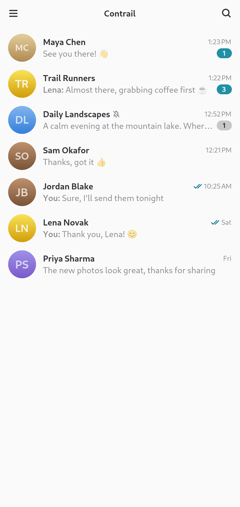
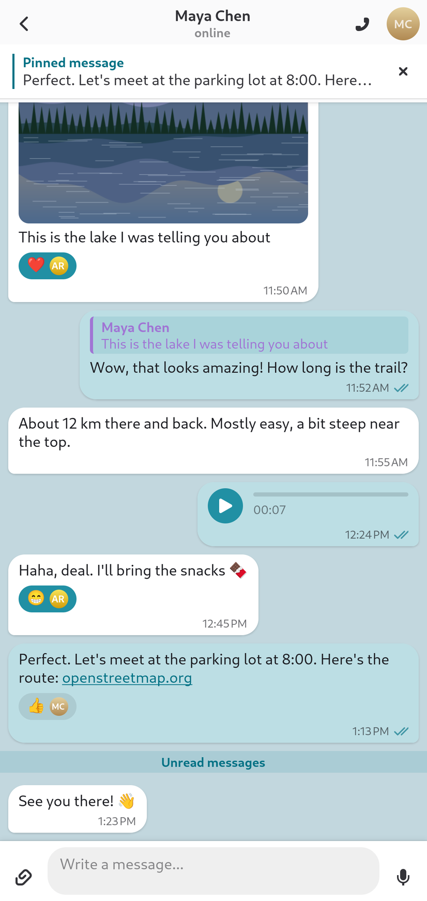
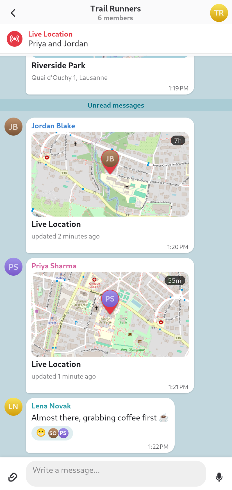
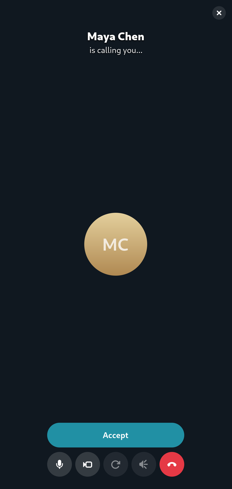
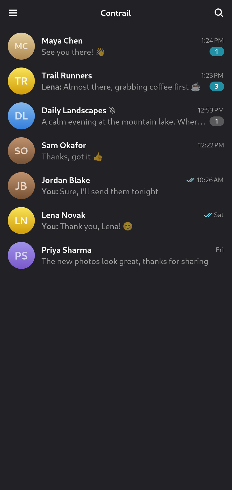
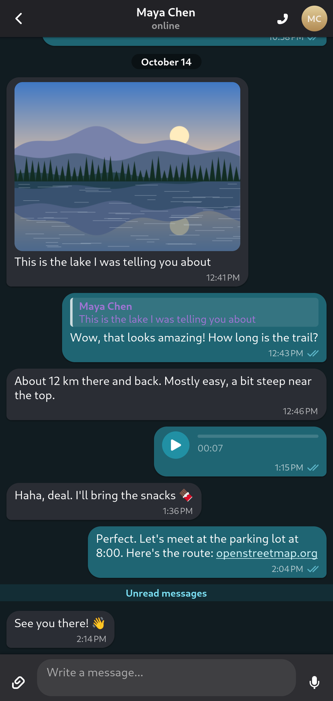
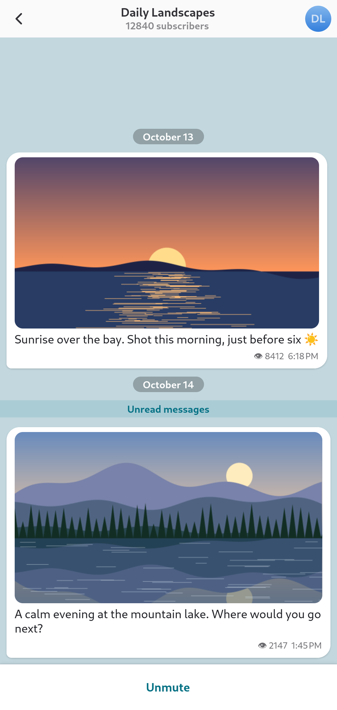
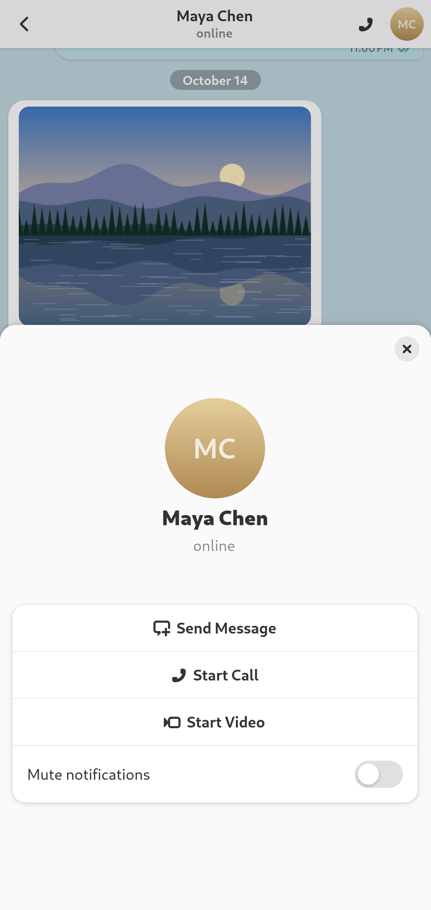

<div align="center">


# Contrail

**A native GNOME (GTK4 + libadwaita) interface for Telegram on Linux phones**

Built on the [Telegram Desktop](https://github.com/telegramdesktop/tdesktop) core · made for Phosh ·
developed on the FuriLabs FLX1s with FuriOS

</div>

<p align="center">
  
  
  
  
</p>
<p align="center">
  
  
  
  
</p>

> [!NOTE]
> Contrail is an **unofficial** client that uses the Telegram API. It is not affiliated with or endorsed by Telegram. The chats in the
> screenshots are made up (see [Screenshots](#screenshots)).

Telegram Desktop works on a Linux phone, but its Qt interface is made for a mouse and a big screen. Contrail
keeps everything below the interface — MTProto, the message database, local storage, media, calls,
notifications — and replaces the interface itself with an adaptive GTK4/libadwaita one: a single column
on a phone, the chat list and the chat side by side on a wider screen, touch gestures, the system's light
or dark style and accent color.

## Features

- **Sign-in** with a phone number, the code and the cloud password (two-step verification); sign-up for
  a new number.
- **Chat list** in Telegram's order: pinned chats, unread and mention badges, previews, drafts, read
  ticks; the archive; search by name and global search by username; pin, mute, archive, mark as read,
  delete or leave from a long press.
- **Chats**: history loaded page by page while you scroll (in both directions, without jumps), date
  separators and an "Unread messages" bar, grouped senders with avatars, replies (tap to jump),
  forwards, formatted text with links, mentions and hidden spoilers, photos with a full-screen viewer,
  stickers, files, videos and GIFs (opened in the system player), voice messages and music (played by
  the core), link previews, polls, shared contacts. Scrolling over text and links never turns into a tap.
- **Writing**: text, replies (long press or swipe left), editing (also Up in an empty field), deleting
  (for everyone too), files and pictures, drafts kept per chat.
- **Voice messages** as in the phone apps: hold the microphone to record and release to send, slide
  left to cancel or up to keep recording hands-free.
- **Calls**: one-to-one audio and video calls — accept or decline, mute, front/back camera,
  encryption emoji, back to an ongoing call from any chat. The remote video fills the window with your
  camera in a corner. As in the phone apps, a call is heard where the sound already goes (Bluetooth or
  wired headphones), otherwise on the earpiece, and can be moved to the loudspeaker or another device;
  each of the phone's outputs keeps its own call volume, apart from the media volume. The screen goes
  dark while the phone is held to the ear, and doesn't lock during a call.
- **Notifications** through the core's native Linux notifications; tapping one opens the chat.
- **Running in the background** (Settings): closing the window keeps messages, notifications and calls
  coming; on a desktop an icon in the notification area opens the window again, on a phone the app's
  launcher does.
- `tg://` and `t.me` links, chat info, contacts, Saved Messages, settings.
- **Every language Telegram is translated into**: the strings are Telegram Desktop's own; on the first
  start the language follows the system.

Not there yet: group calls, screen sharing, stories, reactions, forwarding and selecting messages,
sticker and emoji panels, recording video messages, folders, multiple accounts. Secret chats aren't
planned: Telegram Desktop doesn't have them either.

## Installing

Download the package for your device from the [releases page](https://github.com/x-vlad-x/contrail/releases):

| Device | Package |
| --- | --- |
| Linux phone, ARM64 (FuriOS and other Debian-based systems) | `contrail_<version>_arm64.deb` |
| Linux computer, x86_64 (glibc 2.39 or newer) | `Contrail-<version>-x86_64.AppImage` |

On the phone:

```bash
sudo apt install ./contrail_<version>_arm64.deb
```

On a computer:

```bash
chmod +x Contrail-<version>-x86_64.AppImage
./Contrail-<version>-x86_64.AppImage
```

The packages are ready to use: no building and no Telegram API keys needed. The account and the cache are
kept in `~/.local/share/contrail-data`, separate from the official Telegram Desktop. The installation guide
that comes with each release (`README.md` among its files) has the details, including moving from the earlier
SSH install to the package (`contrail-migrate-launcher`).

Contrail is developed and tested on the FuriLabs FLX1s with FuriOS 14 (Phosh). The Debian package uses the
phone's own GTK, Qt, FFmpeg and other libraries; other aarch64 phones and tablets need GTK 4.12+ and libadwaita
1.6+. Choosing where a call is heard needs `pactl` (PulseAudio, or PipeWire's PulseAudio server); the
earpiece and the loudspeaker are the ports of FuriOS's PulseAudio Droid sink. The dark screen at the ear needs
a proximity sensor behind iio-sensor-proxy (or FuriOS's compatible service).

## Building

You need your own Telegram API credentials: `api_id` and `api_hash` at <https://my.telegram.org> (API
development tools). Put them into `api-credentials.env` in the repository (it's in `.gitignore`):

```bash
TELEGRAM_API_ID=12345
TELEGRAM_API_HASH=0123456789abcdef0123456789abcdef
```

### Packages

```bash
tools/build-packages.sh phone      # out/packages/contrail_<version>_arm64.deb
tools/build-packages.sh desktop    # out/packages/Contrail-<version>-x86_64.AppImage
```

This needs git, patch, python3 and podman (or docker); everything else happens in build containers. The
Telegram Desktop release is pinned in the script; the first build takes a few hours, later ones minutes.
Nothing is installed or uploaded. `tools/prepare_release.py` then assembles the release files (packages,
corresponding sources, checksums) in `out/release/`, see [packaging/LICENSES.md](packaging/LICENSES.md), and
`tools/publish-release.sh` publishes them as a GitHub release for an existing tag.

### Development install over SSH

For working on the interface, `update-contrail.sh` builds the latest Telegram Desktop release with Contrail
and installs it into `~/.local/share/contrail` on the phone over SSH. The build machine needs git, patch,
podman and ssh; the phone must accept SSH logins with a key. No root access on the phone is needed. Don't
combine it with the Debian package on the same phone: its user launcher hides the package's.

```bash
./update-contrail.sh                # build and install
./update-contrail.sh --check        # what is installed on the phone, is there an update
./update-contrail.sh --ui-only      # quickly update only the program (after changes in gtk-ui/)
./update-contrail.sh --build-only   # build without installing
./update-contrail.sh --tag v7.3.1   # a specific Telegram Desktop release
./update-contrail.sh --uninstall    # remove from the phone (--uninstall --purge also removes the account)
```

The SSH destination is taken from `PHONE` (default `furios`), e.g. `PHONE=user@192.168.1.10`.

## How it works

Telegram Desktop's data layer (`Data::Session`, `ApiWrap`, `History`) is tied to its Qt code, so the whole
program is built, with a small patch that adds the interface to its CMake target and starts it at the end
of `Core::Application::run()`. Qt runs on the `offscreen` platform and on GLib's event loop — the same loop
GTK runs on — so both live on the main thread. The GTK interface talks to `Main::Session` directly: it
reads the chat list and the history, follows the core's change streams (`Data::Changes`) and sends
requests through `ApiWrap` and `Data::Histories`. When the core opens a chat in its hidden window (a
notification, a link), the GTK window follows.

The build clones Telegram Desktop at the release tag into `tdesktop/`, applies the patches and builds in a
container: cross-compiled for aarch64 against the same Debian snapshot as FuriOS (code generators that run
during the build go through qemu-user), natively on Debian 13 for the x86_64 AppImage. Libraries Debian
doesn't package (tg_owt, tde2e, tdesktop_rust) are built from source at the versions the official build
uses, so nothing has to be installed on the build machine.

### Project layout

| Path | Contents |
| --- | --- |
| `gtk-ui/` | The interface, C++ on the plain GTK4/libadwaita C API, compiled into Telegram Desktop's executable: `main_window` (adaptive layout), `login`, `chat_list`, `chat_view` (history, scrolling, message field, voice recording), `message` (one message), `text` (Telegram entities → Pango markup, links), `calls`, `dialogs`, `settings`, `style.css`, `icons/` |
| `patches/` | The patches for Telegram Desktop |
| `build-env/` | The build containers (ARM64 cross build, x86_64 desktop build), CMake toolchains, the build of the extra libraries |
| `packaging/` | Launcher, desktop entry, metainfo, icon, install rules, AppImage entry point, release documents |
| `tools/` | Package and release scripts, testing helpers |
| `tests/` | Regression tests (`test-gtk.sh`) and packaging tests (`python3 -m unittest discover tests`) |

## Development

### Testing on the phone

With `CONTRAIL_DEBUG=1` the app takes commands over D-Bus, so it can be driven over SSH without touching
the phone. `tools/phone.sh` wraps that:

```bash
tools/phone.sh run              # start with CONTRAIL_DEBUG=1, the log goes to /tmp/contrail.log on the phone
tools/phone.sh cmd 'chat 0'     # open the first chat
tools/phone.sh cmd history-state
tools/phone.sh shot shot.png    # a screenshot (tools/phone.sh get-grim once)
```

The commands are listed at the top of `gtk-ui/debug.cpp`: opening chats and pages, scrolling, history and
layout diagnostics, a call window preview, local call tests that never contact anybody.
`tools/phone-touch.py` injects real touchscreen drags for testing scrolling and gestures. The core writes
its own log to `~/.local/share/contrail-data/log.txt`.

### Tests

Regressions for the parts that don't need a Telegram account — GTK handler lifetimes, layout on a phone
width, media sizing, telling taps from scrolling, Qt window closing, video frame rotation and audio
routing — run on any Linux desktop with GTK4, libadwaita, Qt 6, libswscale and a C++ compiler, under
AddressSanitizer and UBSan:

```bash
tools/test-gtk.sh
```

The launcher, the migration from the SSH install, the release metadata and the release tooling have their
own tests, which need only Python:

```bash
python3 -m unittest discover tests
```

### Screenshots

The screenshots show the real interface with a made-up account. `tools/demo.sh` starts a second Contrail
on the phone with its own empty data directory and application ID, in English, inside a network namespace
without network; the `demo` command (`gtk-ui/demo.cpp`) signs a fictional account in locally and fills it
with chats, a group and a channel with generated pictures. Nothing reaches Telegram's servers and the
installed Contrail is not touched. The app draws its own window into a PNG, so the phone's screen can be
locked meanwhile:

```bash
tools/demo.sh run               # or: tools/demo.sh run dark
tools/demo.sh cmd demo
tools/demo.sh cmd 'chat 0'
tools/demo.sh shot chat.png
tools/demo.sh stop
```

## License

GNU General Public License v3.0 with the OpenSSL exception, the same as Telegram Desktop; see
[LICENSE](LICENSE) and [NOTICE](NOTICE).

Contrail is an unofficial client, not affiliated with or endorsed by Telegram. Telegram is a trademark of
Telegram FZ-LLC.
