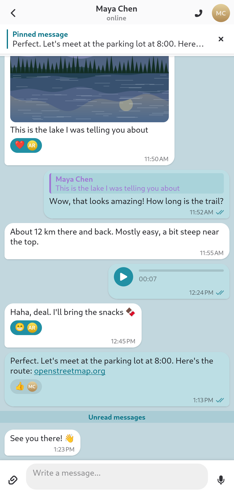
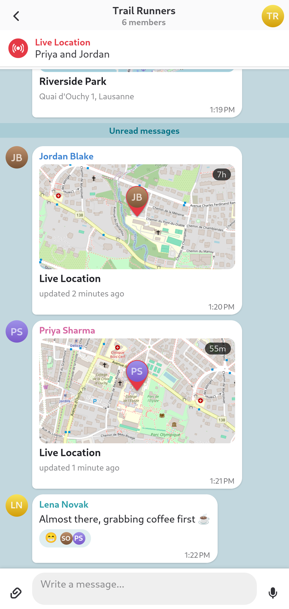
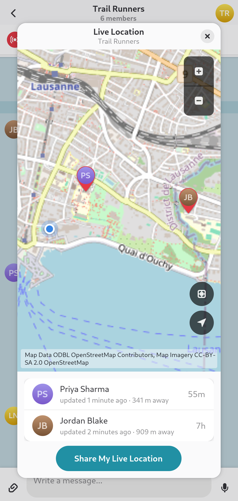
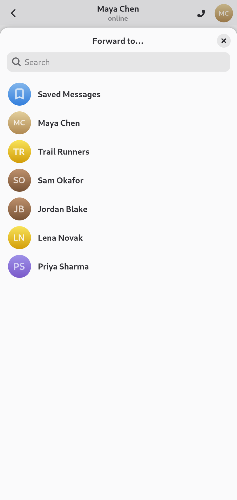

<p align="center"></p>

# Contrail 0.4.0

**Contrail**, a native GNOME (GTK4 + libadwaita) Telegram client for Linux phones, is now built on
[TDLib](https://github.com/tdlib/td), Telegram's library for clients, instead of the Telegram Desktop core. It
starts faster, takes about a third of the memory with the window closed, and its packages are a third of the
size or less. Everything 0.3.1 did is still there. Contrail is made for FuriOS on the FuriPhone FLX1s and now comes
for ARM64 only, as a Flatpak and a DEB. Contrail is an unofficial client that uses the Telegram API; it is not
affiliated with or endorsed by Telegram.

<p align="center">
  
  
  
  
</p>
<p align="center"><sub>Screenshots of a made-up account.</sub></p>

## Downloads

**With updates**: Contrail's own signed Flatpak repository, [flatpak.xvlad.com](https://flatpak.xvlad.com), for
ARM64. Open [Contrail.flatpakref](https://flatpak.xvlad.com/io.github.x_vlad_x.Contrail.flatpakref) in
GNOME Software or another app store, or add it in a terminal:

```sh
flatpak remote-add --user --if-not-exists flathub https://dl.flathub.org/repo/flathub.flatpakrepo
flatpak remote-add --user --if-not-exists xvlad https://flatpak.xvlad.com/xvlad.flatpakrepo
flatpak install --user xvlad io.github.x_vlad_x.Contrail
```

Updates then come through the app store or `flatpak update`. If you installed a downloaded `.flatpak` before,
`flatpak install --user --reinstall xvlad io.github.x_vlad_x.Contrail` moves it to the repository.

**The files** below need no repository:

| Your system | File (ARM64) |
| --- | --- |
| FuriOS, Mobian, PureOS and other Debian-based systems | `contrail_0.4.0-1_arm64.deb` |
| Any Phosh system with Flatpak | `Contrail-0.4.0-aarch64.flatpak` |

```sh
sudo apt install ./contrail_0.4.0-1_arm64.deb              # DEB
flatpak install --user ./Contrail-0.4.0-aarch64.flatpak    # Flatpak
```

No building and no Telegram API keys are needed. `README.md` below is the installation guide: what each package
needs, where your account is kept, and the move from the earlier SSH install (`contrail-migrate-launcher`).

## Updating from 0.3

- **Sign in once.** TDLib keeps its own session and database, and the session of Telegram Desktop's core can't be
  carried over. Contrail explains this on its sign-in page. As with any new sign-in, Telegram asks you to confirm
  it on another device where you are signed in.
- **Your settings come along**: the language, notifications, the sound, the message preview and running in the
  background are read from 0.3's settings on the first start.
- Your cloud chats are loaded again. Files downloaded by 0.3, uploads that never finished and live locations
  shared from 0.3 stay with 0.3: stop a live location before updating, and share it again afterwards.
- 0.3's data (`contrail-data/tdata`) is left where it is, so you can go back to 0.3.1. Once 0.4.0 works for you,
  you can delete that folder to free the space.
- **x86_64 computers stay on 0.3.1**, as do the RPM and the AppImage: from 0.4.0 Contrail comes for ARM64 only.
  0.3.1's files stay on [its release page](https://github.com/x-vlad-x/contrail/releases/tag/v0.3.1).

## What's new in 0.4.0

- **Built on TDLib**: the connection to Telegram, the message database and the files are TDLib's; the interface is
  the same GTK4 and libadwaita one, now without Qt and without Telegram Desktop's core. Contrail keeps only the
  messages near the screen, and TDLib keeps the history on disk.
- **Less memory, a faster start.** Measured on the FLX1s, both as Flatpaks, in one session of the phone:

  | | 0.3.1 | 0.4.0 |
  | --- | --- | --- |
  | Cold start, until the CPU settles | 5.1–8.7 s, 3.6–4.3 s of CPU | 2.9–3.3 s, 2.3–2.4 s of CPU |
  | Window closed, memory (PSS) | 232 MiB | 70 MiB |
  | Window closed, the app's own memory | 89 MiB | 20 MiB |
  | Window closed, threads | 33 | 10 |
  | Flatpak, download | 74 MiB | 13 MiB |
  | DEB, download | 99 MiB | 37 MiB |

  In a day in the background the app's own memory grew by 10 MiB.
- **The graphics driver is let go in the background**: GTK keeps the GPU's driver, with its threads and memory, as
  long as a process lives once it has shown a window. A minute after the window closes, when no call, recording,
  playback or file transfer is running, Contrail starts itself again without a window. Notifications on the screen
  keep working, and opening Contrail comes back to the same chat and place.
- **Proxies** in the settings: SOCKS5, HTTP and MTProto proxies added, edited, checked and switched, and
  `tg://socks` and `tg://proxy` links, which ask first.
- **ARM64 only**, as a Flatpak and a DEB: see Updating above.

## Earlier, in 0.3.1

- **No more freezes while scrolling groups and channels with reactions**: Contrail asked for the reactions of the
  messages on the screen while Telegram Desktop's core was still going through its own list of them, which made
  the core go round that list for 20 seconds and more. On a phone the shell then closed the app, which looked like
  a crash. The reactions are now asked for once the core is done.
- **Seeking in voice messages and music**: the bar under a voice message or a song is a slider. A tap plays it
  from there, a drag moves the position; a drag that starts vertically still scrolls the chat. While a file
  streams, the bar shows how much of it has come, and the label says when playback waits for the next part.
- **Clear download progress**: a video or a GIF being downloaded shows a ring with its progress in place of the
  play button (a tap still cancels it) and how much came, in percent too; a file shows a progress bar under its
  name. A download started with a tap no longer stops showing its progress after the first update.
- **A fast scroll far back loads that place at once**: a fling or a drag of the scroll bar that stops far above
  the loaded messages loads the messages about that far back alone, instead of every page on the way there.
- **Calls without clicks on the FuriLabs FLX1s**: the other side's voice had soft clicks several times a second.
  The phone's sound server takes 40–60 ms of sound at once, and the call kept only 50 ms ready, so the sound
  stopped and started again. The call now keeps as much as the sound server takes plus a margin, 160 ms at most
  (about 100 ms on the FLX1s).
- **About 105 MB less memory**, measured on the FLX1s with an account in the background: Telegram Desktop's core
  no longer keeps what the GTK interface never shows, the source images of every emoji (77 MB), the default chat
  background drawn at the size of the screen (17 MB) and the spell checking dictionaries (10 MB, now neither
  loaded nor downloaded).
- On a wide window, the text of a message no longer runs out of its bubble over the next messages: with a voice
  message or a map in it, and with GTK 4.24 (the Flatpak's GNOME 51 runtime) with any message.

## Earlier, in 0.3.0

- **A Flatpak repository**: [flatpak.xvlad.com](https://flatpak.xvlad.com) serves every release for x86_64 and
  ARM64, signed, with the GNOME runtime from Flathub. Added once (see Downloads above), Contrail updates like any
  other app, through GNOME Software, Discover or `flatpak update`; downloaded `.flatpak` files never updated by
  themselves.
- **Reactions** as in the phone apps: under the messages with their counts, or with the avatars of the few who
  reacted, and custom ones as their pictures. A tap on one adds yours or takes it back, a long press shows who
  reacted. The first reactions are on top of a message's menu, all of them a tap further, and a double tap sends
  your quick reaction. New reactions to your messages show a heart in the chat list.
- **Locations**: a map of the place in the chat; a tap opens an interactive map (OpenStreetMap, drawn by
  libshumate as in GNOME Maps) with "Open in Maps". You can send your current location, any place on the map, or a
  place nearby or found by name.
- **Live locations**: share yours for 15 minutes, an hour, 8 hours or until you stop it. It goes on in the
  background and after a restart; the GPS is used only to take a fix now and then (more often while you move),
  nothing keeps it on. A bar under a chat's header says who shares a live location there and opens **one map with
  everyone**: their pins moving as they are updated, how far each one is from you, and sharing or stopping yours.
- **Pinned messages**: a bar with the pinned message above the chat; a tap shows it and goes on to the one pinned
  before, a list shows all of them. Pinning and unpinning from a message's menu.
- **Forwarding**: choose a chat (and the topic in a group with topics); the messages then wait above its message
  field, to go with a comment or alone, with or without the senders' names.
- **Replies** to a message that isn't loaded yet show "Loading..." and then the message, instead of "Deleted
  message".
- **Memory in long chats**: a chat keeps the rows of the messages near the screen only, where scrolling through
  2000 messages used to keep about 900 MB of them. When the system runs short of memory, Contrail lets go of the
  chats that aren't open, and of the whole interface if it's in the background; the phones have nothing that
  would tell it, so it watches `/proc` itself.
- **A new icon**, also in the notification area of desktops.

## Earlier, in 0.2.1

- **No more freezes on link previews**: a chat with a link preview that has a picture could freeze Contrail for
  good as soon as it was opened, on a phone-sized screen. GTK went round in circles laying out the message,
  because the preview's picture gets taller as the bubble gets wider. The bubble is now laid out without that
  question.
- **Telegram Desktop 7.3.3** core instead of 7.3.1.

## Earlier, in 0.2.0

- **Albums**: photos and videos sent together appear as one message in Telegram's own grid, files and music sent
  together one under the other, every caption kept. Each photo or video of an album opens, has its menu (reply,
  save, delete) and shows its own upload or download progress; a reply or a link to it lights up that one.
  Albums that arrive page by page, lose a message or get their ids from the server keep their place.
- **Files and pictures are shown before they are sent**, from the file chooser or pasted with Ctrl+V,
  Shift+Insert or Paste in the field's menu: a screenshot, an image copied in a browser, files copied in a file
  manager (also through Flatpak's portal). Previews, removing single files, a caption (the text already typed),
  "Send as documents" and "Group items"; pictures go as photos, photos and videos as albums of up to ten, larger
  sets as several albums in order. Folders and unreadable files are refused with the reason, remote links are
  pasted as text, plain text stays text. Cancelling keeps the text and the reply.
- **The photo viewer zooms properly**: pinching keeps the point between the fingers under them (also while they
  move), a zoomed photo can be dragged up to its edges, a double tap zooms to 2.5x around the tap and back, up
  to 6x; Ctrl+wheel with a mouse. Turning the phone keeps the place, the full photo replacing its thumbnail
  doesn't move it.
- **Less memory and fewer wakeups in the background**: with the window closed Contrail releases its interface
  (the chats, the lists, the viewers, their textures) and keeps only where it was. On the FLX1s, after a chat
  with photos was open, it now takes 340 MiB instead of 1148 MiB (PSS) in the background, and wakes up about
  70% less often; photos also take far less memory while the chat is open. Opening the window again comes back
  to the same chat, draft and scroll position, or to the chat a notification or a link points to. Notifications,
  calls, downloads and a voice message being recorded go on meanwhile. See [the measurements](https://github.com/x-vlad-x/contrail/blob/main/docs/measurements-0.2.0.md).
- **Online status**: the account shows as online while Contrail's window is in front, offline once it is
  closed, as in the official apps.
- **Smaller packages**: FFmpeg is built from Debian's source with only what Contrail uses, which leaves out some
  90 MB of codec libraries: the DEB is 97–106 MB instead of 140–153 MB, the Flatpak 72–79 MB.
- Calls no longer leave two of the phone's video devices open after each call.

## Earlier, in 0.1.1

- **Groups with topics**: a group with topics opens its list of topics, with unread badges, previews and pinned
  topics; a topic opens as a chat of its own, where you can read, reply, send text, files and voice messages,
  and keep a draft. Notifications and links to a message in a topic open that topic.

## Earlier, in 0.1.0

- **Packages for every common system**: DEB, RPM, AppImage and Flatpak, each for x86_64 and ARM64. The DEB, RPM
  and AppImage carry the libraries Contrail needs, so one file installs on Debian 13, Ubuntu 24.04, Fedora,
  openSUSE, FuriOS and other systems with glibc 2.39 or newer; the Flatpak runs on the GNOME runtime.
- **Running in the background** (Settings): closing the window keeps messages, notifications and calls coming;
  an icon in the notification area on desktops, the app's launcher on a phone brings the window back.
- **Notifications through the shell**, also while the window is closed, with the phone's own message sound.
- **Incoming calls like the phone's own**: the phone's ringtone (feedbackd), Accept and Decline from the
  notification, and on a locked phone the call fills the lock screen with Mute, the loudspeaker and End Call,
  without unlocking.
- **Where a call is heard**: headphones or Bluetooth when connected, otherwise the earpiece, switchable to the
  loudspeaker or another device; each output keeps its own call volume. The screen goes dark at the ear and
  doesn't lock during a call.
- **Read marks**: opening a chat marks the messages seen as read.

## Everything it does

- Sign-in (code, cloud password), the chat list with pinned chats, archive, search and long-press actions.
- Groups with topics: the list of topics, and each topic as a chat of its own.
- Chats with history loaded while scrolling, replies, forwards, formatted text, photos and albums, stickers,
  files, videos, voice messages (hold to record), link previews, polls, editing and deleting; sending files and
  pasted pictures with a caption; a photo viewer with pinch zoom.
- Reactions, pinned messages, forwarding; locations and live locations, with a map of everyone sharing one.
- One-to-one audio and video calls; notifications; `tg://` and `t.me` links; proxies; every Telegram language.
- Sponsored messages in channels, as the Telegram API terms require of clients that show channels.
- An adaptive layout: one column on a phone, the chat list and the chat side by side on a wider window.

## Known limitations

- Rare media formats (MPEG-2, AVI, WMA and others outside the common ones) are sent and opened as files, without
  a preview.
- Ogg Opus audio files chosen together with other music are sent each on its own: Telegram doesn't take them in
  an album of music.
- In the background Contrail wakes up the phone about once a second, more often than 0.3.1: TDLib's threads
  handle each update from Telegram's servers. It uses 0.04 s of CPU in two minutes. Battery use in the background
  wasn't measured on battery yet.
- The Flatpak keeps its own account and chats, apart from the DEB. A downloaded `.flatpak` file doesn't update by
  itself: the repository does.
- On a locked phone the Flatpak takes calls through Phosh's notification (Accept, Decline, End Call): the
  full-screen call controls need Wayland layer shell, which FuriOS gives only to programs outside a sandbox.
- The maps need the network: they come from OpenStreetMap's servers and aren't kept for offline use beyond
  libshumate's cache.
- Emoji in messages need a color emoji font on the system (the DEB recommends Noto Color Emoji).

## Not there yet

Group calls, screen sharing, stories, voting in polls, selecting several messages, sticker and emoji panels,
recording video messages, folders, multiple accounts. Secret chats aren't planned.

## Tested

<!-- Keep this true for the published files: re-run tools/smoke-test.sh on them and update the lists. -->
- The DEB and the Flatpak of this release were installed on the FuriPhone FLX1s (FuriOS 14, Phosh) and started
  on an offline, made-up account (`tools/smoke-test.sh`): the chats, a chat, the settings and About.
- On the FLX1s with a real account, in test builds of the same code (as a Flatpak, next to 0.3.1): signing in,
  signing out and staying signed in after a restart; sending, editing and deleting messages and a photo's caption;
  notifications with the window closed opening their chat; an incoming video call with the window closed and the
  phone locked, accepted from Phosh's notification, with video both ways; an outgoing voice call of 30 minutes with
  the microphone muted and unmuted; a day in the background (the memory above); the restart without the window
  and coming back to the chat; the update from 0.3.1's settings; removing the test version without touching
  0.3.1.
- Every screen and action on the scripted account in a virtual display (`tools/td-ui-test.sh`): the chat list,
  reading and writing, topics, forwarding, pinned messages, reactions, places and live locations, the photo
  viewer, voice messages and music, recording, sending files and pasting, links, settings, notifications, the
  background, proxies and calls.
- Not checked on the phone with these builds: switching cameras in a call and the screen going dark at the ear,
  Bluetooth and wired headsets, moving between Wi-Fi and mobile data, a real live location, Mobian and PureOS.

## Sources and licenses

GNU General Public License, version 3, with the OpenSSL exception, the same as Telegram Desktop. TDLib is under
the Boost Software License 1.0, and the packages contain other libraries under their own licenses; see
`LICENSES.md`. `Contrail-0.4.0-sources.tar.gz` holds Contrail's sources; the
`Contrail-0.4.0-corresponding-sources.tar.part*` files (see `SOURCES.md`) hold everything else the packages are
built from. Checksums: `SHA256SUMS`.

Telegram is a trademark of Telegram FZ-LLC.
